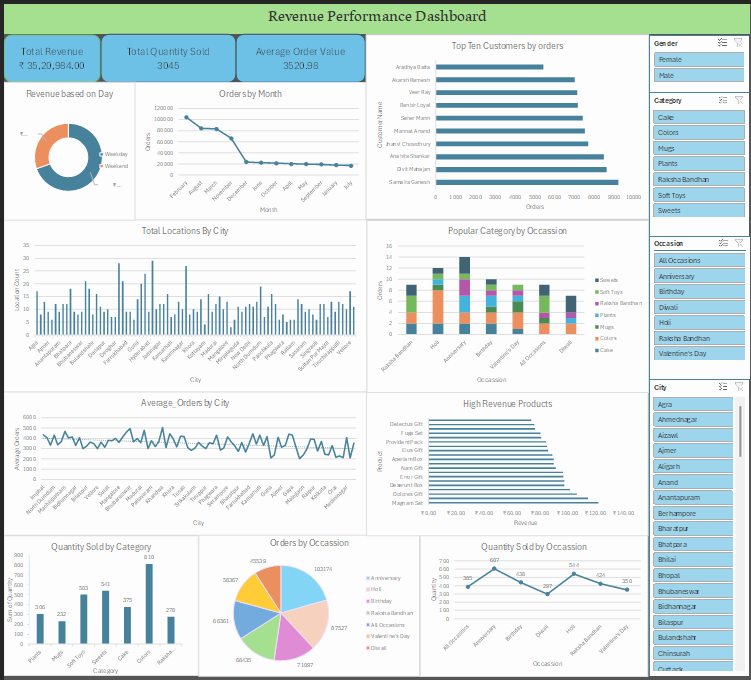

# Revenue Performance Dashboard — Ferns N Petals (Excel)

An interactive Microsoft Excel business intelligence dashboard analyzing **₹35,20,984 in gifting revenue**, **3,045 units sold**, and **1,000+ orders** across product categories, festive occasions, customer segments, and Indian cities.

---

## Project Workflow & Technical Highlights
* **Data Cleaning & Relational Prep (Power Query):** Cleaned raw `Orders` and `Customers` tables from Ferns N Petals (FNP) using **Excel Power Query**—standardizing occasion names, product categories, city names, and weekday/weekend classifications (`DayType`).
* **Dynamic Pivot Modeling:** Engineered multiple structured **Pivot Tables** calculating Total Revenue (`₹35,20,984.00`), Total Quantity Sold (`3,045`), Average Order Value (`₹3,520.98`), weekday vs. weekend splits, and high-revenue products (`> ₹70,000`).
* **Interactive Slicer Controls:** Connected **4 synchronized Excel Slicers** (`Gender`, `Category`, `Occasion`, and `City`) across all 10 Pivot Charts for instant multi-dimensional filtering.

---

## Key Insights & Findings
* **Festive & Occasion Drivers:** **Anniversary**, **Holi**, and **Birthday** lead order volume, while **Colors** (`810` units), **Sweets** (`541` units), and **Soft Toys** (`503` units) drive the highest unit quantities sold.
* **Seasonality & Ordering Behavior:** Order volume peaks sharply during **February (Valentine's season)**, **August (Raksha Bandhan)**, and **March (Holi)**, with **Weekdays** generating the majority of total revenue compared to weekends.
* **Geographic & Product Concentration:** Cities such as **Imphal** and **Kavali** lead average order value, while flagship gift hampers exceeding `₹70,000` drive top product revenue.

---

## Dashboard Preview

